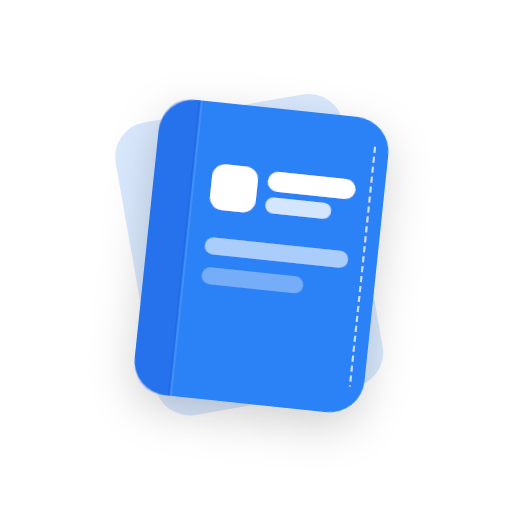
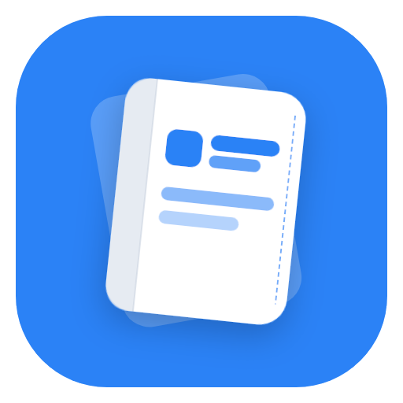
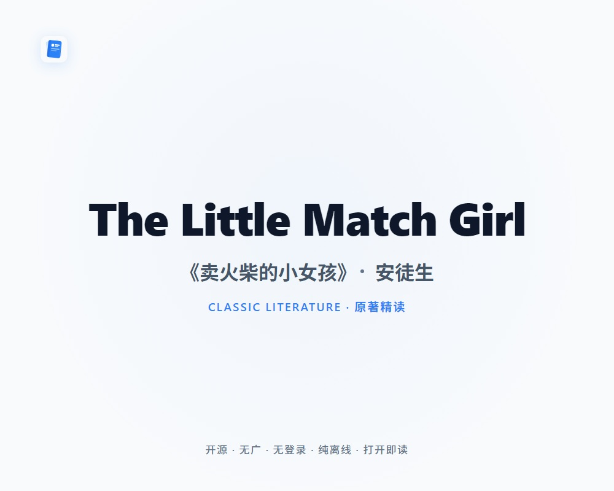

# 🎨 随手读本 · HandyReader 品牌与视觉资源规范 (Brand Assets)

本项目遵循*沉浸、优雅、极简、纯粹*的设计美学，所有官方视觉资源归档于 `docs/images/`。

---

## 1. 官方 Logo 规范

Logo 将**世界经典名著排版美学**与**物理卡片流（Physical Deck Card）**自然结合：
- **卡身与底色**：卡身采用纯正透亮的电光宝蓝（`#2B82F6`），背景为纯净浅灰白（`#F8FAFC`）；
- **立体书脊**：左侧带有一体化深蓝微色阶（`#1D4ED8` 0.32），自然呼应典籍装订；
- **装订虚线**：右侧垂下一道利落的垂直车缝虚线（`stroke-dasharray="6 4"`），赋予封面高级装订质感与呼吸感；
- **版式元素**：经典篇名条与段落流，排版简约克制、秩序井然；
- **极简风格**：纯净通透，在极简现代与文学名著辨识度之间达成优雅平衡。

全套 Logo 均提供 512×512 高清 PNG 及矢量可缩放 SVG 原文件：

| 官方主标：极简白底 (White Squircle) | 官方对照：经典蓝底 (Classic Blue) |
| :---: | :---: |
|  |  |
| [PNG](images/logo-white-blue.png) · [SVG](images/logo-white-blue.svg) | [PNG](images/logo-blue-white.png) · [SVG](images/logo-blue-white.svg) |
| **官方主图标 / 微信小程序主图标** | 品牌经典深蓝对照标 |

---

## 2. 微信小程序官方头像 (WeChat Mini Program Avatar)

针对微信小程序平台（移动端列表、聊天界面、搜索卡片等圆形裁剪场景）专门调优设计的白底圆形头像。

- **文件位置**：[`docs/images/wechat-avatar.png`](images/wechat-avatar.png) (512×512 PNG，矢量源码：[`wechat-avatar.svg`](images/wechat-avatar.svg))
- **视觉特征**：
  - **纯白全出血背景**：与微信整体浅色 UI 无缝融合；
  - **高对比强识别**：在手机端 28~32px 的微缩头像场景下，纯白元素与蓝底产生鲜明反差，辨识度出众；
  - **天然适配圆形裁剪**：居中微倾斜设计，微信圆形裁剪后四周留白呼吸感恰到好处。

---

## 3. 官方小程序码 (Mini Program QR Code)

- **高清展示原图**：[`docs/images/wechat-mp-qrcode.jpg`](images/wechat-mp-qrcode.jpg) (1280×1280 原版高清，用于 GitHub README 与在线大图扫码)
- **体积与分包优化**：已遵照最佳工程实践，不放入小程序主包静态目录，全面采用微信原生 5:4 卡片分享（`onShareAppMessage` / `onShareTimeline`），保持主包总体积仅约 0.62MB。

---

## 4. 微信分享卡片 (5:4 WeChat Share Cover)

针对微信小程序分享给好友、群聊以及朋友圈场景进行黄金比例（5:4 / 1000×800）专属定制。秉承瑞士国际主义极简美学，纯粹大字排版与大面积自然留白，直击“轻松读完世界名著”的核心心智。

  
   
  <b>微信分享卡片效果图（存储于 <code>src/static/share-cover.jpg</code> 与 <code>docs/images/share-cover.jpg</code>）</b>

### 视觉与分享特性
- **左上角微标**：独立微缩 Logo 图标，零文字干扰，极致通透。
- **视觉重心**：名著英汉大字排版（`The Little Match Girl` / `《卖火柴的小女孩》· 安徒生`，点号绝对几何居中）+ 经典原著徽标。
- **底部注脚**：精致微型文本 `开源 · 无广 · 无登录 · 纯离线 · 打开即读`。

---

## 4. 品牌保护与知识产权声明 (Intellectual Property & Trademark)

- **品牌独占权**：「随手读本」与「HandyReader」的项目名称、品牌 Logo、微信头像、UI 视觉设计语言专属原作者 lanzm 所有。
- **授权范围界定**：本项目遵循 CC BY-NC 4.0 协议开源，仅限代码层面的个人学习研究与非商业自用，**未授予任何商标权、商用权或品牌换皮仿冒许可**。
- **侵权维权声明**：任何个人、第三方团队或商业机构，严禁将本项目代码二次打包植入广告上架营利，或冒充「随手读本」官方进行分发传播。原作者保留依法在各平台（包括微信公众平台侵权投诉渠道）发起侵权下架及法律追责之全部权利。
